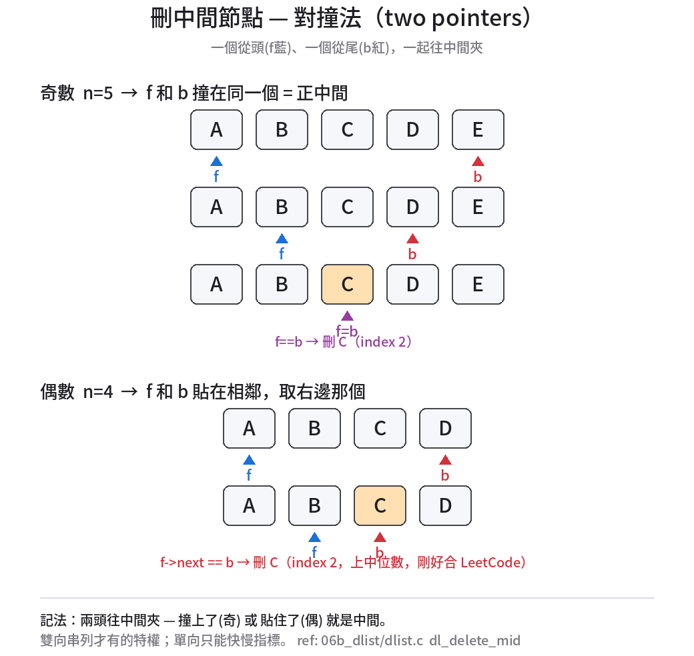

## 一個 Java 工程師的冷寫練習

我是 Java 工程師，最近在補 C。練法很土：把一個寫過、通關過的資料結構，整個 `git reset` 成空白，再白紙重寫一遍。這次是**雙向鏈結串列**（doubly linked list）。

其中一題是 LeetCode 2095：**刪掉串列的中間節點**。聽起來簡單，但它逼你想清楚兩件事——怎麼「找到」中間，以及怎麼「乾淨地」刪掉。

## 笨方法，和一個更好的方法

最直覺的做法：先走一遍數出長度 n，再走 n/2 步到中間。兩趟。

但如果是**雙向**串列，你有個單向串列沒有的特權：**從兩頭一起往中間夾**。

```c
front = l->head;          back = l->tail;
while (front != back && front->next != back) {
        front = front->next;   /* 從左往右 */
        back  = back->prev;    /* 從右往左 */
}
/* 迴圈結束，back 就是要刪的中間節點 */
```

兩個停止條件，剛好對應奇數和偶數長度：

- `front == back` → 兩個指標撞在同一個 → 奇數長度，正中間
- `front->next == back` → 兩個指標貼在相鄰 → 偶數長度



偶數長度其實有「兩個中間」。這個迴圈天生選**第二個**（上中位數 ⌊n/2⌋）——剛好就是 LeetCode 2095 的定義。不是我多聰明，是停止條件自然落在那。

## 我不小心用了兩種手法

有意思的是，同一題我在另一個版本（環狀串列）用的是另一招——**快慢指標**：

```c
slow = head->next;  fast = head->next;
while (fast != head && fast->next != head) {
        slow = slow->next;
        fast = fast->next->next;   /* 走兩步 */
}
/* fast 到底時，slow 在中間 */
```

兩招都對，但適用範圍不同：

| | 對撞法 | 快慢指標 |
|---|---|---|
| 原理 | 兩頭往中間夾 | 一個走 1 步、一個走 2 步 |
| 單向串列 | ❌ 不行（沒有 `prev`） | ✅ 可以 |
| 雙向串列 | ✅ 可以 | ✅ 也可以 |

結論：同一題可以有不只一種解。對撞是雙向串列的**特權**，快慢指標則兩種串列都吃。

## 真正的坑：測試全過，ASan 卻爆了

演算法其實不是這次最大的收穫。刪除函式寫完，`make test` 跑出來——**全過**：

```
  delete mid: ok
  free non-empty: ok (confirm with `make asan`)
All tests passed!  Now run `make asan` -- that is the real judge.
```

最後那句我差點跳過：**「make asan 才是真裁判」**。跑下去：

```
SUMMARY: AddressSanitizer: 80 byte(s) leaked in 5 allocation(s)
```

洩漏。而且每一條都指向同一個地方：`dl_new` 裡 malloc 出來的那個 `struct` 本身。

我的 `free` 函式長這樣：

```c
void dl_free(struct dlist *l)
{
        char *s;

        if (!l)
                return;

        while ((s = dl_remove_head(l)))
                free(s);
        /* ← 少了一行 */
}
```

我把串列裡**每個節點**都釋放了，卻忘了釋放「**裝節點的那個盒子**」——`dl_new` 一開始 malloc 的 `struct dlist` 自己。補上 `free(l);`，ASan 歸零。

## 帶走的三件事

1. **雙向串列刪中間，優先想對撞法**；單向才退回快慢指標。
2. **偶數長度有兩個中間**，停止條件決定你拿哪一個——想清楚規格要的是哪個。
3. **「測試全過」會騙人。** 清內容和清容器是兩件事；記憶體對不對，ASan 說了算，不是 `make test`。

這種「全綠但其實漏」的差距，正是我從 Java 的 GC 世界換到 C 最需要補的肌肉——沒有人幫你收，盒子也要自己丟。

---

想一步一步看指標怎麼走？我把這題做成了[互動小課：刪中間節點](/lessons/dlist/delete-middle.html)。
